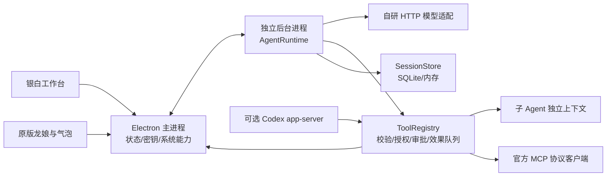

# DragonAgent 自研内核实现

DSH 仅用于理解会话隔离、事件记录、工具执行管线和生命周期。执行循环、协议适配、预算、摘要、调度和恢复均由 `packages/agent-core` 自行实现。没有引入第三方 Agent 执行框架。

## 框架边界

`AgentRuntime` 负责组织上下文、请求模型、接收与验证工具调用、执行并回传结果、持续推理、追问、审批、取消和错误恢复。`ModelAdapter` 统一三类协议，保留必要的原生续接内容；同一配置换了协议、端点或模型时不回传旧的续接字段。`ToolRegistry` 校验 JSON Schema，执行授权回调，统一审批和副作用队列。文件与浏览器宿主使用细粒度审批，经同一个内核审批通道持久化。

内核不导入 Electron 或 React。SQLite 单独导出，默认内存实现可直接在普通 Node 中运行。密钥通过宿主回调获取。内核生命周期事件携带精简状态，完整消息由存储接口读取，避免把巨大历史反复广播给界面。

MCP 使用官方 TypeScript SDK 处理协议；连接、发现、命名、参数校验、审批、超时、取消及重连策略由本框架负责。本地 stdio 使用有限环境变量，不继承整份宿主环境。未知影响的 MCP 和命令串行；断线后仅下一次明确调用重连，不重发失败操作。

## 协作与副作用

只允许主 Agent 创建/管理子 Agent。子 Agent 继承模型和授权，或选择用户已配置的其他模型；不复制整个父上下文。父子任务均持久化目标、状态、用量和结果。父任务结束前等待子任务，并把有来源的结果交回父模型汇总。

默认限额为并行 3、总子任务 12、共享模型请求 64。包括重试和摘要；耗尽后暂停，等待用户继续。停止主任务取消整树，停止一个子任务只影响该分支。内核在异步读取存储之前先占用会话，桌面也做重复命令去重。

首版对所有写入和影响不明确的操作使用一个保守的串行队列，读操作可并行。文件覆盖还须携带读取时的 SHA-256 版本；执行前及审批后检查文件身份，拒绝过期版本与等待期间发生的变化。浏览器操作串行，每个 Agent 使用独立浏览器目录。

## 预算、持久化和迁移

总预算含系统提示、工具定义、历史、结果和附件；上限 524288 tokens，输出上限 32768，预留摘要空间。支持精确计数适配器，否则保守估算并明确标记。小窗口按比例缩小。摘要按有界分段生成，保留目标、约束、结论、变更和未完成事项；每个摘要请求计入共享额度。完整原文和大结果保存为附件。

工具开始记录先落盘再执行，结果确认后再记完成。恢复时不运行旧审批或工具；未确认结果补为未知。已记录的重复调用 ID 返回保存结果，不再次执行；同一 ID 改变参数会停止。网络重试仅限收到 HTTP 429/5xx 且尚未获得完整响应的请求，流中断不会重新请求后再执行部分工具。

旧数据库先 `VACUUM INTO` 备份，再迁移到 v2。DSH 原生会话只读，摘录通过新会话草稿交给用户审核；配置、密钥和记忆保留。DSH、Cordis、桥接配置以及专用独立 Node 发行文件已移除。原项目只读，不复制其凭据、数据库或浏览器用户目录。

## 协议参考

- [OpenAI function calling](https://developers.openai.com/api/docs/guides/function-calling)
- [Anthropic tool definitions](https://platform.claude.com/docs/en/agents-and-tools/tool-use/define-tools)
- [MCP 官方 TypeScript SDK](https://github.com/modelcontextprotocol/typescript-sdk)

测试证据、发行验收及未完成的在线验证单独记录在 `docs/ACCEPTANCE.md`。
