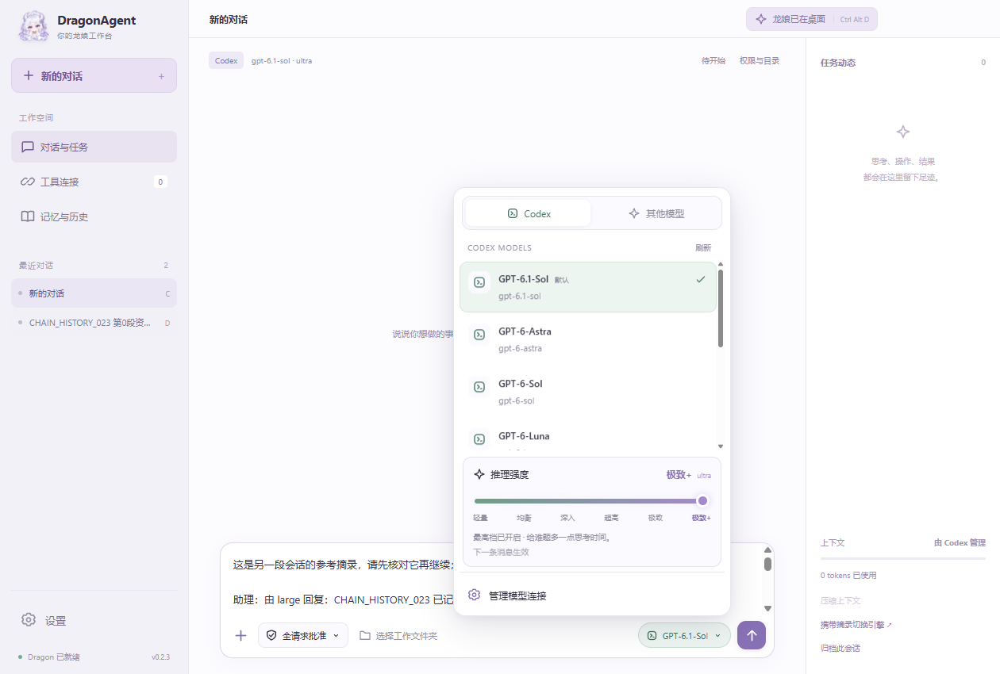

# DragonAgent 0.2.3

银白龙娘主题的 Windows 桌面 Agent。**独立 TypeScript 执行内核；DSH 只作为架构参考，没有 DSH SDK、服务或运行依赖。** 工作台与原版龙娘共享聊天、草稿、任务和审批。

## 界面

[权限菜单](docs/screenshots/permissions-dark.png) · [深色窗口](docs/screenshots/window-dark.png)

## 使用

下载对应版本的安装包，或完整解压便携 ZIP 后运行 `DragonAgent.exe`。模型 API 与 Codex 登录在本机配置，仓库不包含账号数据。

本机直接双击 `E:\Projects\DragonAgent\release\win-unpacked\DragonAgent.exe`。这是已更新到 0.2.3 的固定启动入口，仍使用原应用数据目录。

安装包与便携 ZIP 在 `release/0.2.3`：可运行 `DragonAgent-Setup-0.2.3.exe` 安装，或将 `DragonAgent-0.2.3-win.zip` 完整解压后运行其中的 `DragonAgent.exe`。请保留可执行文件旁的资源目录。桌面使用不需要安装 Node 或 Python。网页操作需要 Google Chrome。

1. 在「设置 → 模型 API」添加服务地址、模型 ID、API Key 和服务商实际提供的上下文窗口。支持 Chat Completions、Responses、Anthropic Messages。
2. 新建聊天，在输入框右下角的模型按钮中选择「其他模型」下的 API 配置，选择工作文件夹，然后发送任务。模型按需要调用文件、浏览器、命令、MCP 或子 Agent 工具。
3. 在全请求批准模式下，文件变更会展示内容并请求批准。覆盖已有文件必须先读取它，携带读取到的版本提交修改；版本变化会拒绝覆盖。全请求批准模式下命令需启用并逐次审批，另外两档自动批准命令。
4. 「工具连接」中填写 Tavily 密钥并启用，或添加自己的 stdio / Streamable HTTP MCP。连接失败可以点击「连接已启用服务」重连。失败操作不会自动重发。
5. 「设置 → 任务协作与调用额度」调整限额。默认并行 3 个子任务、每棵任务树最多 12 个子任务、64 次模型请求。摘要和重试也消耗额度。右侧任务树可查看结果、用量，或停止单个子任务；停止主任务会停止整个任务树。
6. 右上角「召唤龙娘」或 `Ctrl + Alt + D` 显示/收起桌宠。原来的外观、动画和手势保留：单击看回复、双击看 Codex 额度、聊天按钮输入、拖动移动、右键菜单。需要确认时可直接在气泡内审批主任务和子任务。

Codex 是可选的外部通道：在设置中登录账号后，通过模型菜单中的「Codex」页签选择模型，并用滑条调节该模型支持的推理强度。最高档有短暂光晕动画。模型与强度在当前会话保存；其上下文策略独立；动态文件、浏览器和 MCP 工具直接接入 Dragon 工具层。关闭工作台会收进托盘，任务继续；托盘右键可退出应用。

同一 Dragon 聊天可在任务结束后直接更换模型，历史和草稿保留；跨 Codex / Dragon 通道会携带可审核摘录创建新聊天。权限说明位于权限菜单各选项中。

## 霜璃、参考资料与对话权限

默认人设是银白长发、紫瞳的龙娘霜璃：闲聊轻快，做事认真。已有对话继续时也会采用新的人设。

输入框左下角的“+”可上传文件或关联历史聊天。支持 UTF-8 文本/代码、PDF、DOCX 和 PNG/JPEG/WebP/GIF；单文件最多 32 MB，每条消息最多 10 份资料。图片导入副本会适配到最长边 1536 像素，原文件不变；GIF 读取静态帧。PDF/Word 本地提取文字，扫描文档暂不做 OCR。关联聊天保存文字快照，不继承原会话权限。草稿附件、引用和权限在工作台与气泡同步。

“+”右侧的权限仅作用于当前对话，任务运行时不能切换：

- **全请求批准**：读取、文件修改、浏览器和外部工具操作请求确认。
- **帮我批准**：自动批准工具和命令；文件与浏览器工具仍遵守当前授权范围。命令以当前系统账号运行，不是操作系统级目录沙箱。
- **完全放开**：自动批准，并允许访问其他目录和网站，仍保留文件版本校验、取消和子任务范围约束。

官方 DeepSeek API 配置默认提供 deepseek_web_search / deepseek_web_fetch，复用该配置密钥；可在模型设置中关闭。不需要 DSH，也不要求 Tavily。工具结果保留来源，查询失败会显示错误。

## 上下文与本地数据

自研通道的**总上下文上限为 524,288 tokens（512K，非字节）**，取它与配置的模型窗口的较小值。最大输出不超过 32,768 tokens，预留摘要空间，约 80% 开始压缩；小窗口按比例缩小输出和预留。默认适配器使用保守估算，界面明确标记；服务商返回的用量会覆盖估算显示。可扩展适配器提供精确计数。应用无法扩大模型本身的窗口。

摘要保留目标、约束、结论、文件变更和未完成事项；工具调用及结果成对保留。完整压缩前历史和大型工具输出保存为本地附件，可按需读取。API 请求重试不会再次执行已有工具结果；中断后缺失结果标为未知，不自动重放审批或副作用。

数据在 `%APPDATA%/DragonAgent`，独立于两个原项目。`dragonagent.db` 保存桌面状态、配置、记忆和系统加密后的密钥；`agent-core.db` 保存内核记录、工具/审批事件与附件。模型密钥通过私有进程通信交给后台，不写入模型配置或日志。Codex 使用应用自己的账号目录。

升级前自动备份旧版数据库。旧 DSH 会话成为只读历史，继续时新建 Dragon 会话，把可编辑的文字摘录放进草稿，审核后再发送，不复用 DSH 原生状态。Legacy 也只读导入。长期记忆只保存用户明确选择的内容。

子 Agent 不得扩大父任务授权，只接收分配的目标和资料。命令和外部 MCP 程序仍按当前 Windows 账号权限运行；审批和范围检查不等于操作系统容器。

## 开发与独立框架

主要语言为 TypeScript；Electron + React 承载桌面。开发需要 Node 24、pnpm。`pnpm install` → `pnpm build` → `pnpm start`。

- `packages/agent-core`：独立框架、公开 API 与 SQLite 适配；详见包内 README。
- `src/main/agent-worker.ts`：Electron 独立后台进程中的宿主适配。
- `src/main/dragon.ts`：桌面与后台通信；`runtime.ts` 管理界面状态和系统能力。
- `src/main/codex.ts`：可选 Codex app-server 通道，工具直接走 Dragon。
- `src/pet`、`assets/skins`：复用的原版龙娘和受控文件/浏览器工具。
- `src/renderer`：银白工作台、共享气泡与协作任务树。

独立运行：`node examples/node.mjs`。默认使用本地 HTTP 模型模拟器，完成两轮对话和两次工具调用，不需 Electron、真实密钥或付费请求。`--live` 使用明确设置的 `DRAGON_BASE_URL`、`DRAGON_MODEL`、`DRAGON_PROTOCOL`、`DRAGON_API_KEY`，可选 `DRAGON_CONTEXT`。`npm pack ./packages/agent-core` 可生成其他 TypeScript 项目安装的框架包。

## 验证与构建

- `pnpm test`：协议、并行/取消、授权、预算、压缩、冲突写入、MCP 故障与迁移恢复。
- `node scripts/ui-check.mjs`：真实 Electron + 本地模型服务，跨窗口草稿、重复发送、审批、子任务和落盘结果；截图在 `test-results`。
- `node scripts/compositor-check.mjs`：浅色、深色背景上的 Windows 桌面透明合成检查。两种界面测试均可通过 `DRAGON_EXE` 指定发行版入口。
- `node scripts/smoke.mjs`：独立数据目录的启动检查。
- `pnpm exec tsx scripts/codex-check.ts`：原生 Codex 初始化；不登录、不发送模型请求。
- `pnpm package`：构建、复制已安装的固定版本 Codex 原生程序、准备标准 npm 运行依赖，再生成 Windows x64 安装包和 ZIP。
- `node scripts/release-check.mjs`：核对发行依赖、构建文件和交付校验值；需先把独立内核包放入对应发行目录。
- `pwsh -File scripts/promote-release.ps1`：完成发行检查且应用没有执行任务并退出后，逐文件校验新版本，备份旧固定入口并完整替换。不会覆盖 `%APPDATA%/DragonAgent`。
- `node scripts/run-live-check.mjs`：显式启动真实发行版的在线验收模式，使用应用原有加密环境读取已保存的凭据，进行模型计算工具、Tavily 搜索和 Codex 只读任务验证。报告不含密钥。

Electron 界面测试请从正常 Windows 用户环境运行；受限账号的 AppContainer 权限可能导致 Electron 在创建窗口前异常退出。发行包不含测试数据、账号、密钥或浏览器用户目录。

本地模拟验收和真实在线验收分开记录，见 `docs/RELEASE-0.2.3.md` 和 `docs/ACCEPTANCE.md`。本地模拟通过不代表在线服务已验收，具体状态以记录为准。
