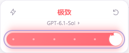
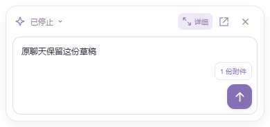

# DragonAgent 0.2.4

历史对话可以删除，桌宠增加简约输入版，Codex 推理强度改为独立红色滑条浮层。

## 使用变化

- 最近对话右侧增加垃圾桶；「记忆与历史 → 全部历史对话」包含已归档记录，也能删除。确认对话标题后执行删除，运行中或正在处理附件时拒绝删除。
- 删除清理 DragonAgent 对话、子任务记录、内核事件、大结果附件和上传文件副本。工作目录中的文件、明确保存的长期记忆、其他聊天中的摘录以及 Codex 自己的原生历史保留。此操作不是磁盘安全擦除；旧备份不会被修改。
- 删除先持久化，再清理缓存；未完成的清理会在下次启动重试，重启不会恢复已删除聊天。重复删除请求不会影响其他对话。
- 桌宠默认显示简约输入版。右上角「详细」展开原有对话、权限、附件与模型设置；「简约」收回。选择会保存在本机，设置页也能切换。草稿、附件和发送／停止状态保持共享。
- 简约版以「待确认」提示打开详细审批，以「查看回复」打开聊天。第一次使用可直接输入并发送，自动新建聊天。
- Codex 模型按钮旁增加推理强度入口。260px 小浮层使用红色粗滑轨、白色圆形滑块、离散档位圆点、模型入口和重置按钮；最高档有短暂动画，尊重减少动态效果偏好。可用档位来自当前 Codex 模型目录，重置恢复该模型默认值。

## 集中验收

2026-10-30，全部功能完成后执行：

- 构建与现有 29 项测试通过；未新增单元测试。
- `scripts/chrome-check.mjs` 在开发构建和最终 0.2.4 EXE 上通过。覆盖删除／取消删除、归档删除、重复请求、运行中拒绝删除、数据库与附件清理、其他聊天摘录及记忆保留、重启持久化、简约／详细切换与共享草稿、推理重置／最高档动画／键盘焦点、两种主题、最小窗口与 150% 页面缩放。
- 该流程还复验 Dragon 模型切换、16K 窗口压缩、跨通道摘录与草稿保留、窗口最大化和关闭到托盘。Codex 使用本机真实 `model/list` 目录验证档位；模型回复与压缩使用本地模拟 HTTP 服务。
- `scripts/ui-check.mjs` 在最终 EXE 上通过：原桌宠透明与手势、双窗口重复发送防重、主／子任务文件审批、简约版待确认入口和共享草稿。没有渲染进程错误。
- `scripts/features-check.mjs` 通过：TXT／PDF／DOCX／图片／聊天附件，以及三档权限执行行为。
- 发行检查通过：4196 个应用文件未发现 DSH／Cordis 执行依赖，编译文件逐一匹配；EXE 和安装包中的 7 个头像尺寸匹配。便携 ZIP 完整性检查通过，安装包与 ZIP 的 SHA256 已生成。

本版没有重新发起真实模型、Tavily 或 Codex 推理请求，不能把本地模拟结果视为新的在线验收。0.2.3 的真实 API 结果保留在对应发行记录。本版未修改协议适配器或独立内核公开接口。也未在全新 Windows 虚拟机测试安装／卸载；150% 检查是页面缩放。

## 交付入口

固定入口：`E:\Projects\DragonAgent\release\win-unpacked\DragonAgent.exe`。

发行目录：`release/0.2.4`，包含安装包、便携 ZIP、独立内核包和 `SHA256SUMS.txt`。替换固定入口前备份旧发行目录，应用数据与密钥仍使用原来的 `%APPDATA%\DragonAgent`。

