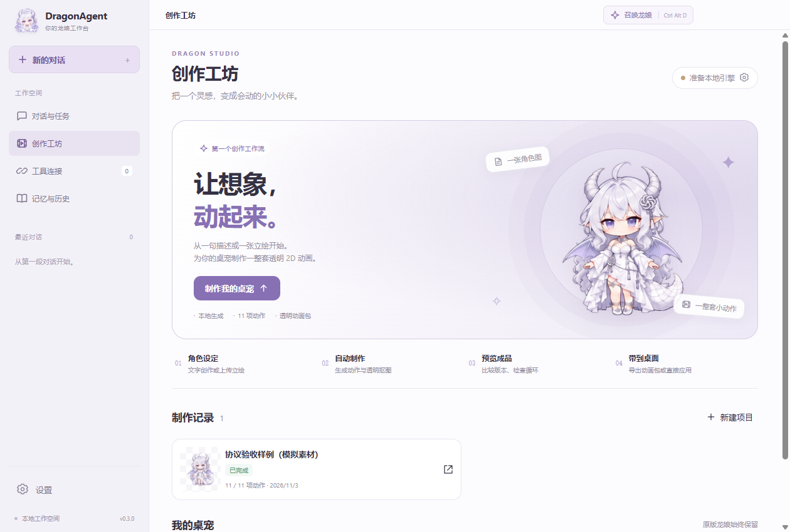
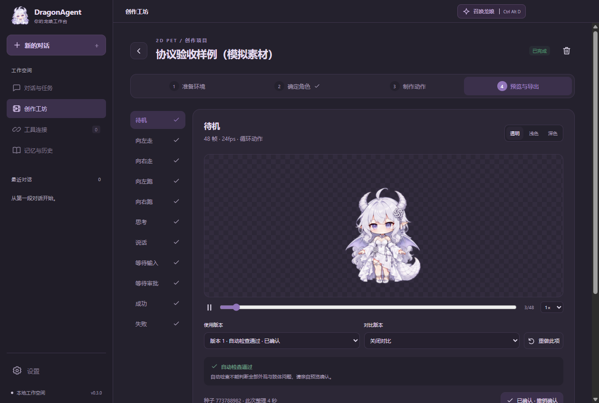

# DragonAgent 0.3.0 · 创作工坊

新增独立于聊天任务的本地 2D 桌宠制作工坊。现有 Dragon / Codex 聊天、权限、共享草稿和原版银白龙娘继续保留。

## 这次可以做什么

- 从文字或上传立绘开始，确认角色后制作待机、左右走路、左右跑动、思考、说话、等待输入、等待审批、成功、失败共 11 项动作。
- 通过本机 ComfyUI 调度 SDXL、Wan 2.2 TI2V 5B 与 BiRefNet ToonOut。视频输出直接保存 PNG，再抠图、选择正向连续循环片段、统一画布与缩放；不使用倒播或默认镜像。
- 查看生成进度、修改单项动作、保留并比较版本；支持逐帧、速度、透明／浅色／深色背景与整体锚点预览。
- 确认全部动作后，导出含 PNG 帧、图集、skin.json 和制作来源的 ZIP，或加入素材库并应用。原版龙娘可随时恢复。
- 工坊数据单独持久化；重启先查询原任务。取消不会调用 ComfyUI 的全局中断接口，不影响其他队列任务。提交结果未知时需要先核实，不自动重复生成。

ComfyUI、节点和模型独立安装，不打入发行包。安装位置、默认模型文件名和连接方法见 [工坊指南](CREATIVE-STUDIO.md)。应用及工作流调度使用 TypeScript；没有新增自有 Python 后端，也没有 DSH 执行依赖。

## 集中验收记录

日期：2026-11-03。目标机器：Windows x64、RTX 4060 Laptop 8GB、16GB 内存。

现有 29 项自动测试通过。工坊验收使用真实 HTTP、WebSocket、SQLite、PNG 处理 Worker 与 Electron 页面，但由本地协议模拟服务重放素材，**不执行 AI 推理**。完整动作包、导出再加载、应用／恢复、断线和重启恢复、重复请求、取消及失败显示均分别检查。没有新增大量单元测试。

恢复验收发现并修复了两类问题：任务刚从队列转入历史时被误判丢失，以及损坏的提交／历史响应被当成可以丢弃的操作记录。最终结果以本版验收报告为准；原失败日志保留在本机。

最终集中检查结果：

| 检查 | 结果与范围 |
|---|---|
| 现有自动测试 | 29/29 通过；独立内核公开接口未改变 |
| 工坊协议与文件链路 | 16 项场景通过，154 次模拟任务请求；覆盖缺少模型／节点、畸形响应、断线、显存不足、恢复、取消、最多两次质量重试、导出再加载和素材保留 |
| 0.3.0 EXE 工坊 | 5 组检查通过；实际应用中的文件导入、Sharp 图片 Worker、ZIP 导出、浅深主题、最小窗口、100%／150% 页面缩放、逐帧和版本对比、应用／恢复桌宠 |
| 0.3.0 EXE 原功能 | 双窗口防重、草稿共享、主／子任务审批与落盘、原桌宠透明和手势；删除／归档历史、简约／详细气泡、推理滑条、Dragon 模型切换与小窗口压缩、跨引擎摘录、窗口最大化及关闭到托盘通过 |
| 附件与权限 | TXT、PDF、DOCX、图片、聊天摘录及三档权限通过；没有渲染进程错误 |
| 发行内容 | 4317 个应用文件扫描通过，没有 DSH／Cordis、独立 node.exe、模型权重或账号数据；编译文件与当前构建一致，Sharp 原生模块和 Codex 原生程序齐备 |
| 图标与归档 | EXE 和安装包中的 7 个头像尺寸匹配；便携 ZIP 完整性检查通过，三项交付物的 SHA256 已生成 |

本机报告位于 test-results/workshop-integration.json、workshop-ui.json、chrome-024.json（脚本沿用旧文件名，报告内版本为 0.3.0）、features-check.json 和 release-check.json。报告及模拟素材目录不上传 GitHub，也不打入发行包。

### 真实生成尚未验收

用户正在独立准备 ComfyUI 和模型。当前默认本机地址尚未响应，因此本版尚未实测真实文字生图、11 项动作成片、角色一致性、肢体正确性、边缘闪烁、显存峰值和制作耗时。模拟服务的数据、画面和 GPU 数值不能作为这些项目的验收证据。

数值质量检查不替代人工预览。自动检查最多重试两次；显存不足保留结果并报告错误，不把失败动作标为完成。模型许可由各模型作者提供，安装包不分发权重。

本版未重新发起真实模型 API、Tavily 或 Codex 推理请求，之前的在线结果保留在对应发行记录。150% 界面检查是页面缩放，不是修改 Windows 系统 DPI；本机没有全新 Windows 虚拟机进行安装／卸载全流程测试。

## 启动和下载

已完成原入口替换并启动验证，使用 Dragon 内核。旧 0.2.4 备份至 .cache/legacy-release-0.2.4-20261103-091708；逐文件校验新载荷一致。更新前后 1 份模型配置、2 份加密密钥及 8 个历史对话的指纹一致，记忆未变化。验证过程中没有解密或输出密钥。对应记录为 test-results/promotion.json 和 release-data-preservation.json。

固定启动入口：`E:\Projects\DragonAgent\release\win-unpacked\DragonAgent.exe`。

发行目录：`release/0.3.0`，交付安装包、便携 ZIP、独立核心包与 SHA256SUMS.txt。更新固定入口前检查未完成任务并备份旧版本；原应用数据、模型配置、密钥和历史位于原来的 %APPDATA%\DragonAgent，不随发行目录替换。

打开后进入左侧「创作工坊」→「准备本地引擎」，填写 ComfyUI 启动日志中的地址并检测连接。

## 界面截图

以下为真实 Electron 窗口，制作记录使用明确标注的模拟素材，仅展示界面。

