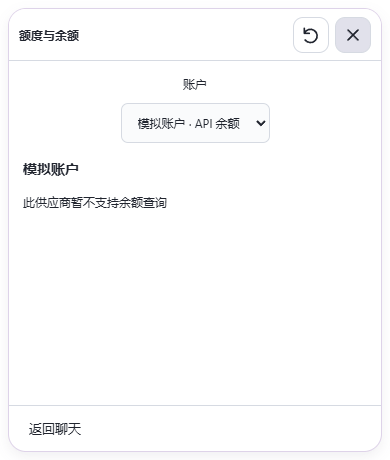
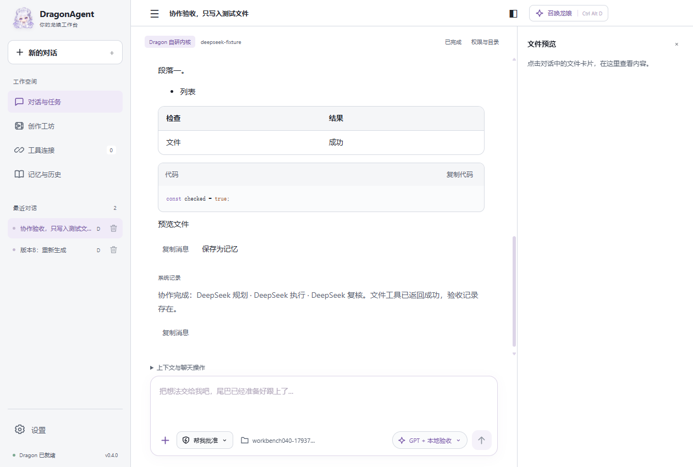
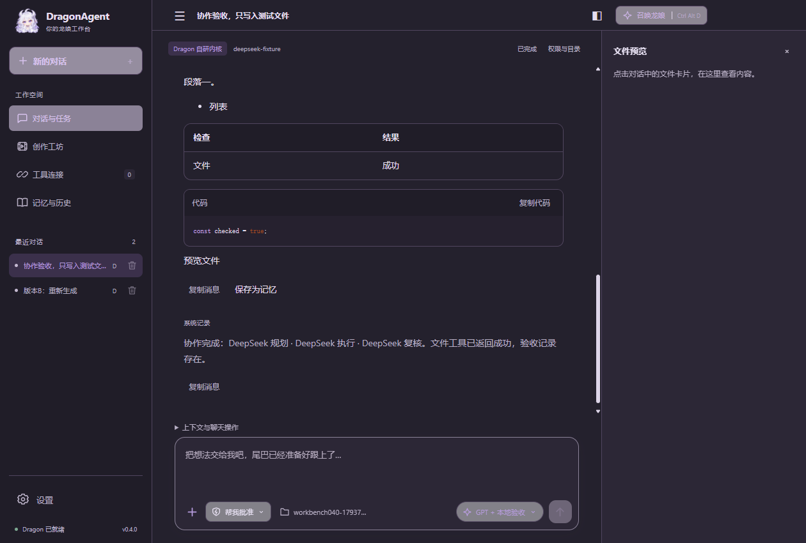

# DragonAgent 0.4.0 发行记录

本版优先交付自研 Agent 工作台与龙娘交流。桌宠动画制作已按用户决定暂缓，旧项目和素材保留在「历史工坊」；完整 11 项动画不作为本版验收条件。独立角色插画计划于 0.5.0 交付，当前版本不包含 Pixiv 自动选图与自动启动 ComfyUI。

## 新增与调整

- 白色／月夜紫工作台，侧栏折叠、统一消息与工具时间线、流式命令输出、审批与文件卡片。
- Markdown、圆角表格、代码复制、`==重点==`、NOTE/TIP/WARNING/IMPORTANT 提示卡；正文不执行 HTML，HTML 产物使用隔离预览。
- 消息编辑与版本切换、文件预览、Git／SQLite／时间／记忆工具、GitHub MCP、DeepSeek 搜索／识图／余额。
- GPT 规划 → 用户确认 → DeepSeek 执行 → GPT 复核，包含降级、预算和停止处理。
- 龙娘双击显示「额度与余额」，支持 Codex 双额度条与已配置 API 账户切换；目前 API 余额实现 DeepSeek，其他服务明确显示不支持。
- 气泡关闭按钮 36×36，固定标题区、Esc 收起，刷新不得重新打开已关闭气泡。
- 气泡独立选择聊天，按内容自动接续，可固定、手动选择；无匹配时新建“全请求批准”聊天。匹配失败有本地回退提示。
- 气泡附件单独导入和路由，不覆盖工作台草稿及附件；忙碌聊天排队，重复请求去重，重启不自动重放队列。

## 验收证据

本地检查与真实服务分开记录，不以模拟代替在线验收。

- `pnpm test`：29 项通过，涵盖三类协议、MCP 故障、预算、子任务、权限与恢复。
- `scripts/workbench040-check.mjs`：工作台、文件、SQLite、命令、消息版本、PDF 与交互 HTML 隔离通过。
- `scripts/bubble040-check.mjs`：跨聊天匹配、焦点和草稿保留、附件隔离、防重复、排队、新聊天权限通过；实际关闭点击、Esc、余额选择、浅深主题 100%／150% 缩放通过。
- 真实 DeepSeek Search／Fetch／识图／余额通过；GitHub 只读仓库搜索及 Tavily 搜索通过。
- 真实协作闭环使用 `gpt-6-astra`／`high`，GPT 规划和复核、DeepSeek 文件写入与读取通过，无降级、无越界子任务。
- Anima 和 Animagine 真实立绘已验证；动画未通过完整验收，停止作为交付要求。

在线报告和用户资料保存在本机 `test-results`，不提交凭据、原始个人聊天或用户生成素材。

## 交付状态

2026-11-04 已重新构建，发行依赖、图标、构建一致性及打包后气泡集成检查通过。已完整替换固定入口并逐文件核对复制哈希，升级后模型配置、13 段聊天和 4 项加密凭据核对一致。

数据备份：`.cache/userdata-pre040-final-20261104-161655`；旧发行备份：`.cache/legacy-release-0.3.0-20261104-162306`。

交付文件位于 `release/0.4.0`，含安装包、便携 ZIP、独立内核包及 `SHA256SUMS.txt`。

- 安装包 SHA256：`5a150f5c9529dbc06402846e3b096160d1de289c9057cdf6e3bf3cca35b98ebe`
- ZIP SHA256：`ad7edc61e1eb714b6984c28018f4e1ed9d55c72e3bd556fd88f62fecb5f20e96`

目标入口：`E:\Projects\DragonAgent\release\win-unpacked\DragonAgent.exe`。
